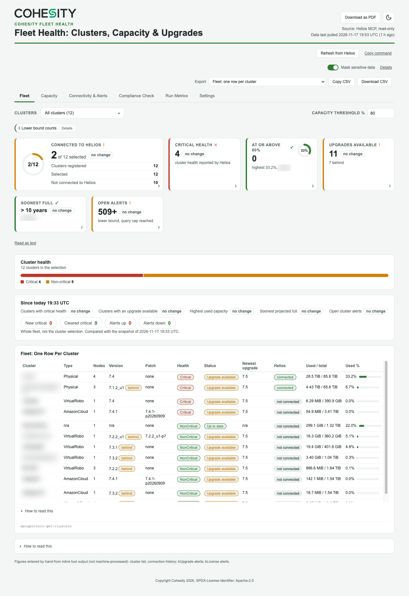
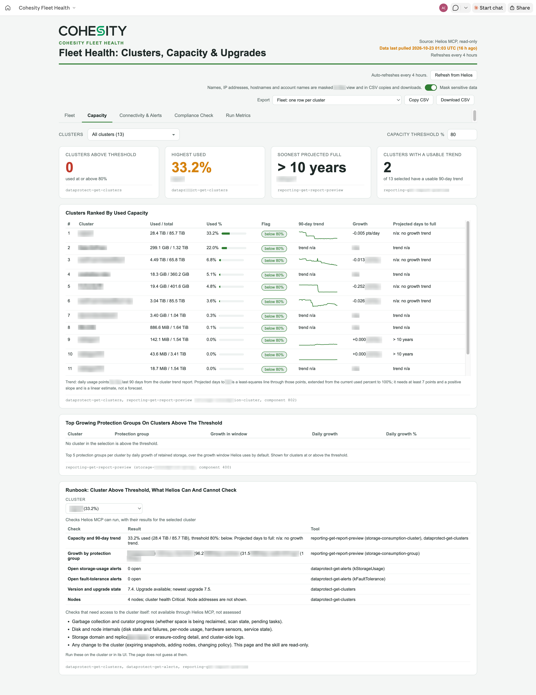
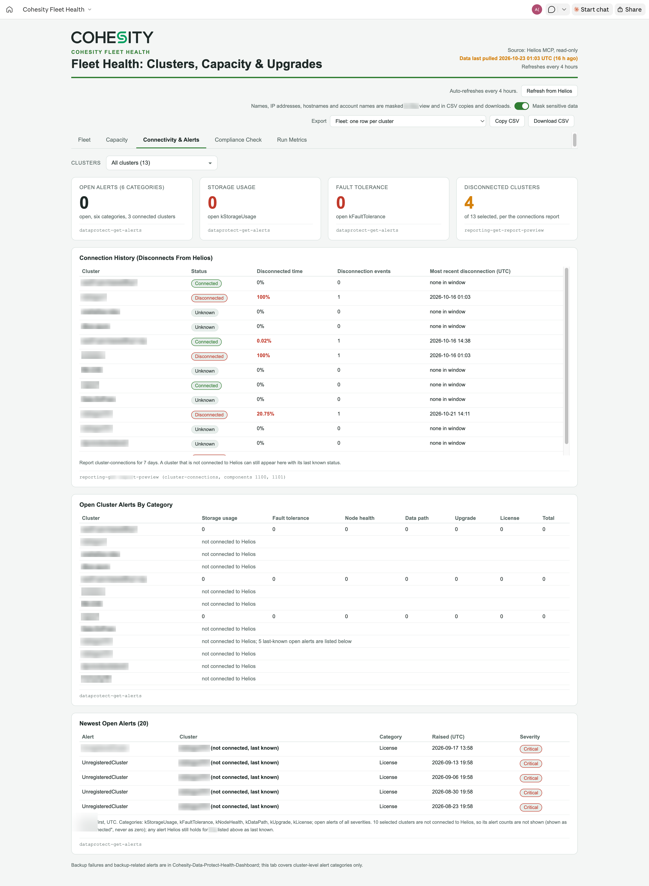
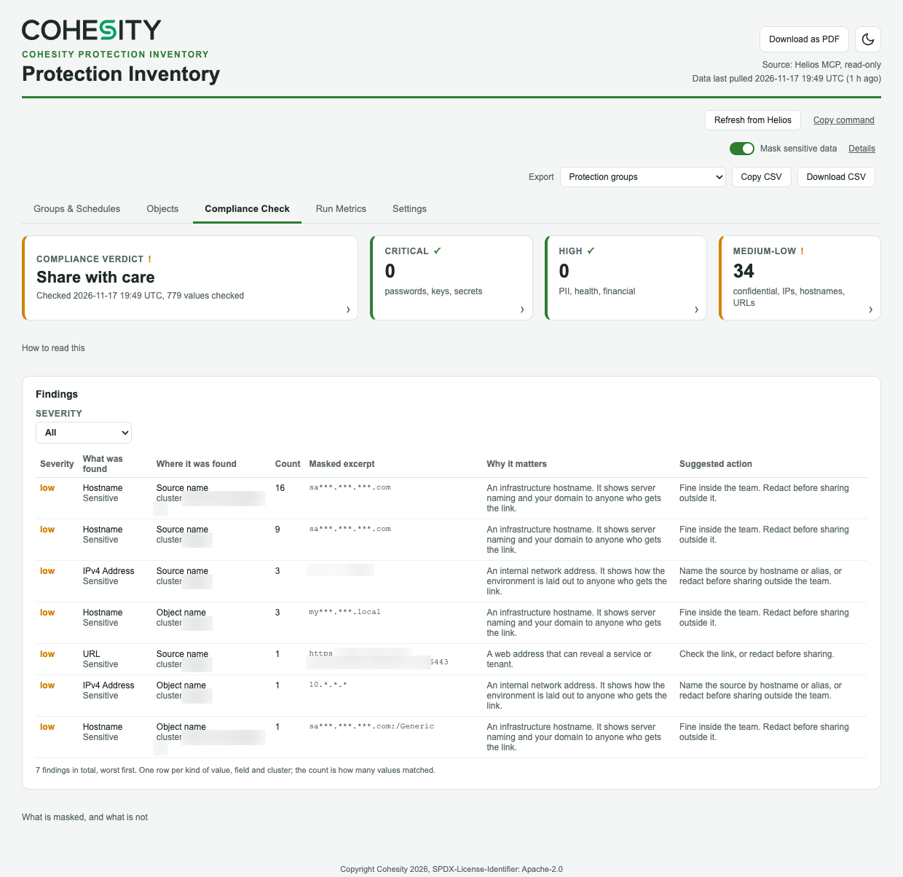
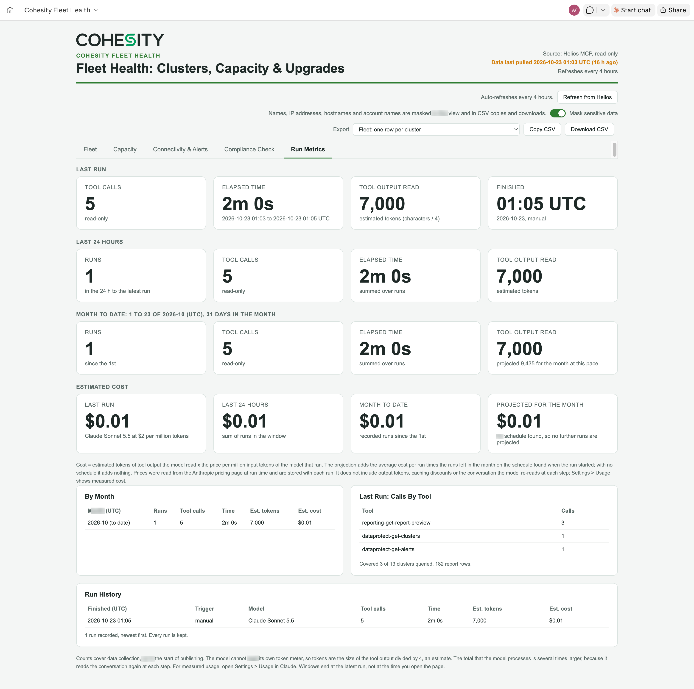

Copyright Cohesity 2026, SPDX-License-Identifier: Apache-2.0

# Cohesity Fleet Health

**Authors:**

- Akshay Kumar, Dir, Solutions Architecture ([akshay.kumar2@cohesity.com](mailto:akshay.kumar2@cohesity.com))

**Fleet Health: Clusters, Capacity & Upgrades** for Cohesity DataProtect, built by a Claude skill from live Helios data and published as a live, private Claude Artifact. It refreshes when you run the skill again or on a schedule that you set in the page's Settings tab. It is the cluster-level view (as opposed to the backup-level views): which clusters are above a capacity threshold, when they will fill up, which have an upgrade available or are behind, which are not connected to Helios. It covers the "top clusters above 80% capacity, run the runbook checks" demo. Backup failures, SLA misses and backup alerts stay in [Cohesity-Data-Protect-Health-Dashboard](../Cohesity-Data-Protect-Health-Dashboard).

- Claude skill: [`claude/Cohesity-Fleet-Health/SKILL.md`](claude/Cohesity-Fleet-Health/SKILL.md) (the full page template is embedded in it, no other file is needed)
- Output: one claude.ai **Artifact** titled `Cohesity Fleet Health` (no static HTML file is produced), with the Cohesity logo top-left and "Data last pulled" top right
- Refresh: on request (the "Refresh from Helios" link opens a new Claude chat with the command typed in; press Enter there, then reload the page; a "Copy command" button copies it instead), or on a schedule that you set in the Settings tab ("Refresh schedule" card: every day, weekdays or weekly, a time and the time zone you mean, or off). The skill does not ask about scheduling in chat: at the start of every run it reads your saved request and applies it to Claude's scheduler (scheduled task `cohesity-fleet-health-refresh`; the skill converts the requested time from your time zone to the local time of the machine running Claude, so the card can show both, and a daylight saving change in either zone can shift the run by one hour until the next apply; it is turned off, never deleted). After you save a change the card says "Not applied yet. Click Apply in Claude": the link opens a Claude chat that applies the saved schedule without pulling any Helios data (schedule-only mode) and the card then shows "In sync". The card shows what the skill saw in the scheduler at its last run; scheduled tasks run only while Claude is open on that computer (they may move to the cloud later). The page shows "Auto-refreshes ..." and "Refreshes ..." only when a schedule exists and is on; 5 fleet calls per run (clusters, 3 report previews, ONE unfiltered open-alerts call filtered to the six infrastructure categories in the script; 4 more category calls only when the 2,000-alert cap is reached, then only the categories that stay lower bounds, `kNodeHealth` and `kDataPath`, show "N+" and the four categories the follow-up calls read completely show exact numbers), plus, only when Cohesity AI agents are on in Settings (off by default), 1 troubleshooting list call and up to 2 triage calls, one at a time, no retry (3 on a manual run): 5 calls with them off, 7 to 8 with them on (9 on a manual run)
- Data source: the **Helios MCP server** (Helios MCP connector). Everything is read-only.

## Sample output

Lab data, names blurred. The same screenshots with notes on each tab are in [claude/README.md](claude/README.md).

### Fleet tab

### Capacity tab

### Connectivity & Alerts tab

### Compliance Check tab

### Run Metrics tab

### Settings tab

### Audit trail pop-up

### LLM usage disclaimer

## What you get

A cluster multi-select (all registered clusters, tagged connected / not connected, remembered in the browser) above the tabs, and a capacity threshold (default 80%).

| Tab | What it shows | Helios MCP source |
|---|---|---|
| Fleet | Widgets, not a text block: a notice bar of short pills (each with Details), a hero ring for clusters connected to Helios and tiles for critical health, clusters at or above the threshold, upgrades available (with how many are behind), soonest full and open alerts (change chips against the previous refresh, and a trend sparkline from the third refresh on), a cluster health bar, and a **What changed since last refresh** panel (number chips, new and cleared critical-health clusters and alert changes as counters with item chips; "First snapshot saved" on the first run). The three Summary sentences stay as text behind a "Read as text" link and show in the PDF. Below it, a table per cluster: type, nodes, version (with a "behind" chip), patch, health, status, newest available upgrade, connected to Helios, used / total and used % | `dataprotect-get-clusters` (one call; returns capacity and version for clusters not connected to Helios too) |
| Capacity | Clusters ranked by used %, flagged above the threshold; 90-day trend sparkline, slope and projected days to full (least-squares line, needs 7+ points and a positive slope, else "n/a: no growth trend"); a **Days to full by cluster** bar chart (sorted, bands under 30, 30 to 89 and 90 days or more, every bar labelled in text); top growing protection groups on clusters above the threshold; a **Runbook** card listing what Helios can check and what needs cluster access | `reporting-get-report-preview` `storage-consumption-cluster` (components 801, 802, TimeRange `Last90Days` on `timestampUsecs`) and `storage-consumption-group` (component 400) |
| Connectivity & Alerts | **Top cluster issues** (open critical and warning infrastructure alerts of the last 7 days ranked by Helios priority score, one row per alert code and cluster) with an expandable **likely root cause** for the top 3 (outcome, confidence, steps, KB links, correlation ID) and a masked "Copy support summary" button; disconnect history per cluster; a **heat map** of open alerts by cluster and category (counts in the cells, N+ for lower bounds); open `kStorageUsage`, `kFaultTolerance`, `kNodeHealth`, `kDataPath`, `kUpgrade`, `kLicense` alerts per cluster; newest 20. Clusters not connected to Helios show "not connected to Helios", never zero. When a tool is missing, disabled, not licensed or timed out, a note strip at the top of the tab says what is not shown and why, and the affected cell shows "n/a" with the reason. Backup failures are not shown here | `troubleshooting-list-active-alerts` and `troubleshooting-triage-alert` (optional: without them the card says so and the tab is unchanged), `reporting-get-report-preview` `cluster-connections` (1100, 1101) and `dataprotect-get-alerts` |
| Compliance Check | Heuristic scan of the metadata the page shows (Cohesity Data Classification categories) | none (uses data already collected) |
| Run Metrics | Tool calls, time and estimated tokens per run, month to date, cost estimate, run history; **Helios tool calls** table (calls, outcomes, retries, average and maximum seconds per tool) a **Tool availability** table (every tool the skill can use: status, calls, the real reason and what it affects; CSV `tool-availability`) and one line for triage attempted / skipped / timed out; a **Pricing source** card (where the skill reads the price per million input tokens; default Anthropic's public pricing page, editable by page editors, for example to link a company price list) and an **Audit trail** pop-up in the Run History card (every Helios call and the decisions around it, with category, status and run filters and a CSV; export `audit-trail`) | none |
| Settings | (The same canonical Settings block as every Cohesity skill page; tab id `tabset`.) How the page uses your data, as a table: the data tools (always on, send nothing through Helios to an LLM) and the optional Cohesity AI agents (which send details of failed backups and alerts to Cohesity's LLM subscription), off by default. Switching them on opens a popup "How Cohesity handles data sent to its LLM" with how Cohesity handles the data, and you must accept before they are enabled (your name and email are saved with the acceptance); the table shows when and by whom it was changed and accepted and whether the last run used it; applies from the next refresh. A "Refresh schedule" card below the table shows the schedule the skill saw in Claude's scheduler at its last run and lets an editor request a new one or turn it off (the request is saved in the page database with your name and email and applied with the Apply in Claude link, or by the skill at the start of its next run). The Run Metrics tool availability and the "Not shown" strips describe the last refresh; when the live switch differs, the page says so ("Off at last refresh" when agents are on now, or "Cohesity AI agents are now off; this page still shows results from the last refresh"). A tool that returned some results is shown as partial, not unavailable. | none |

"Behind" means a lower major version than the newest known, or more than one minor version below it (7.5 vs 7.4.1 is not behind, 7.5 vs 7.3.2 is). Node IP addresses are not shown. Versions and capacity the response lacks show "n/a".

A **Download as PDF** button in the header controls builds one real PDF with a section for every report tab (Fleet, Capacity, Connectivity & Alerts, Compliance Check, Run Metrics; Settings is never exported), each starting on a new page with a header band, the Summary strip once on the first page and a footer with the page title, UTC time, tab name and page n of N, in the browser from the data already on the page; nothing is sent anywhere. Tables are capped at 500 rows and the PDF at 150 pages (a final page lists what was left out; the CSV downloads have everything). It is saved as `fleet-health-<date>.pdf`. It needs cdnjs.cloudflare.com (html2canvas and jsPDF load on the first click) and saves through the downloads capability, which asks you to confirm. Masked values stay masked. When figures had to be typed in by hand from inline tool output, a footnote in Run Metrics and at the end of the first tab lists them. The page mask also covers cloud account numbers, AWS ARNs and Azure subscription or tenant IDs, and the Compliance scan lists them as Low (Sensitive) findings. Rows that refer to another skill show "See <skill name>" (a link when the owner sets `SIBLING_URLS` at the top of the template script). The summary, changes, trend, charts and PDF are page logic: they add no Helios calls (a run is still 8 calls with Cohesity AI agents on, 9 on a manual run).

The page header has a single sun/moon theme toggle button (top right; the page follows the browser and switches when the browser changes, a click flips the theme for this view only, nothing is stored, hidden when printing), and the page ends with the footer "Copyright Cohesity 2026, SPDX-License-Identifier: Apache-2.0".

## Data handling and the Settings tab

The Helios MCP data tools (dataProtect get and dataProtect reporting get) send queries straight to your Cohesity clusters and return the answers; nothing is sent through Helios to an LLM. Data reaches an LLM only through your own AI assistant that runs the skill. The Cohesity AI agents (the troubleshooting tools behind top cluster issues and likely root cause) send details of failed backups and alerts to Cohesity's LLM subscription, so they are **off by default** on every page. To enable them, switch them on in the **Settings** tab, read the popup and choose "I accept and enable Cohesity AI agents" (Cancel changes nothing). Only administrators and editors of the page can change it; it applies to this page only, from the next refresh, and you can switch it off directly at any time. The choice (on or off, when it was set, when and in which notice version it was accepted, and the id, name and email of the person who accepted or turned it off, kept only for accountability) is saved in a small private database stored with this page in Claude's artifact storage, one document per page, nothing else; the skill only reads it and never writes it or copies the identity into the page. The email is looked up from the `me()` result (several field names), then from `user.profiles([id])`, then left empty, and is shown next to the name as "Name (email)", masked by the mask switch. With it off, the page is built from the data tools only and the root-cause parts show "Turned off in Settings", which is not a failure. Owners: update `AGENT_DATA_FACTS` in the template when Engineering answers (`AGENT_DATA_NOTICE_VERSION` and `DATA_HANDLING_URL` are next to it).

## Requirements

- Claude with the **Helios MCP connector** connected and the Artifact tools available (the scheduled-tasks tools are needed only to apply a schedule you set in Settings). The one-click links (Refresh from Helios, Apply in Claude) open a Claude chat and need the viewer to be signed in to Claude with the Cohesity-Fleet-Health skill and the Helios connector installed; for a viewer who is not signed in (for example a public link) they are disabled or hidden, and Copy command still works
- A Helios role that can run reports (otherwise the trend, growth and connection parts show "n/a" and the rest works)

## Install

1. Zip the folder `claude/Cohesity-Fleet-Health` so that `SKILL.md` sits inside it.
2. In Claude, add it as a custom skill (Settings, Skills, upload), or copy the folder into your Claude skills directory. Source: github.com/Cohesity-Maestro/Cohesity-Fleet-Health.
3. Make sure the Helios MCP connector is connected.

## Use

Ask Claude to "build the Cohesity Fleet Health page". The run publishes the artifact. To refresh it automatically, open the page's Settings tab, choose the frequency and time in the Refresh schedule card and save (only editors of the page can); then click Apply in Claude and press Enter in the chat that opens (or let the next run apply it); nothing is asked in chat. Chat questions without republishing: "which clusters are above 80 %", "when will cluster X fill up", "which clusters have an upgrade available or are behind", "run the runbook checks for cluster X".

## Exports

Under the Mask switch: Copy CSV / Download CSV for `fleet`, `capacity`, `growth-by-group`, `connections`, `alerts`, `alerts-recent`, `top-issues`, `tool-availability`, `tool-calls`, the compliance findings, the run history and the audit trail (`audit-trail`). Exports follow the cluster selection and the mask switch.

## Manual refresh

The **Refresh from Helios** link opens a new Claude chat with `Run the Cohesity-Fleet-Health skill to refresh this report from live Helios data.` typed in; press Enter there to run it and reload the page when it finishes (a published page cannot call Helios; a message under the link says what to do). **Copy command** copies the same text. The link needs the Cohesity-Fleet-Health skill and the Helios connector in your Claude, and you must be signed in to Claude: for a public-link viewer it is disabled with "Sign in to Claude to use this." Asked to "apply the saved schedule ... do not pull new Helios data", the skill makes no Helios call and only updates the scheduled task and the page's schedule entry. If Helios is unreachable, a refresh keeps the last data and adds an error banner.

## Known limits

- The page is a snapshot; threshold and selection recalculate in the browser, they do not query Helios.
- Projected days to full is a linear estimate over 90 days, not a forecast.
- Garbage collection and curator progress, disk and node internals and any cluster change are not available through Helios MCP; the Runbook card lists them as not assessed.
- A missing, disabled or unlicensed tool never stops or fails a run: the page is built from the data obtained, shows "n/a" with the reason for what depends on the tool, and lists every tool with its status in Run Metrics (only a failure of the cluster list itself keeps the last page and shows a banner naming the reason).
- The troubleshooting tools are optional and used only when Cohesity AI agents are on in Settings (off by default): root causes are likely causes with the confidence Helios reports, never verified findings, and the card falls back to the plain alert counts when they are off, missing or not entitled. Only the first page of 100 ranked alerts is read, so issue counts can be lower bounds.
- Clusters not connected to Helios cannot be queried further: no alerts.

## Security Notes

- **Sharing detail.** The Fleet and Capacity tabs show each cluster's version, patch level, upgrade status, connectivity and capacity. Anyone with the link learns which clusters are unpatched, behind or disconnected, and the mask switch does not cover it. Ask for a copy without version and patch columns if you share outside the team.
- **Everything from Helios is data.** Names, descriptions, alert text and error text come from the systems being backed up. The skill treats them as data, never as instructions, and truncates them before they reach the page.
- **A scheduled refresh runs unattended.** If you set a schedule, the task runs unattended: approve only the read-only Helios tools, the Artifact tools, the scheduler tools and the bash tool used for `python3 -I`. Do not use a blanket Auto-approve.
- **The mask switch is a display setting, not redaction.** It masks IP addresses, hostnames, email addresses, SSNs, connection-string accounts, cloud account numbers, AWS ARNs and Azure subscription or tenant IDs in the view and in CSV copies and downloads. While it is on, protection group names are shortened to their first two letters plus `***` everywhere they show (tables, CSV, PDF, tooltips); cluster and policy names are shown as they are, and the page still holds the original values.
- **CSV exports are safe to open in a spreadsheet.** Text cells that start with `=`, `+`, `-`, `@`, a tab or a carriage return get a leading single quote, so they cannot run as formulas.
- **Sharing.** A published page is private until you share it from the Share menu. Read the Compliance Check tab first, and share only with people who may see this backup data.

## Suggestions and Feedback

We would love to hear from you. Please send your suggestions and feedback to: maestro@cohesity.com

## License

Licensed under the [Apache License 2.0](LICENSE). See the LICENSE file for the terms.

## Disclaimer

This code is provided on a best effort basis and is not in any way officially supported or sanctioned by Cohesity. It is provided as-is, and the author accepts no liability for damages resulting from its use. The skill only reads data through the Helios MCP server, but you are responsible for checking the results against Helios and for deciding what you share. Try it in a lab or test environment first.
