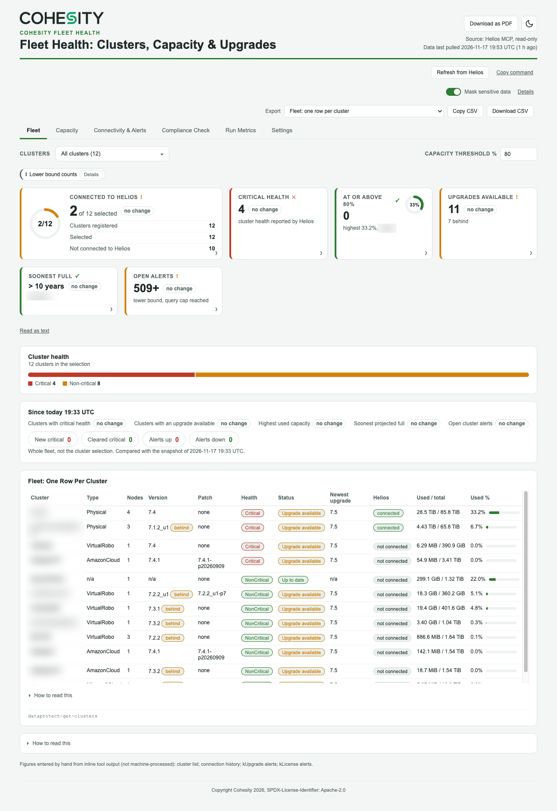
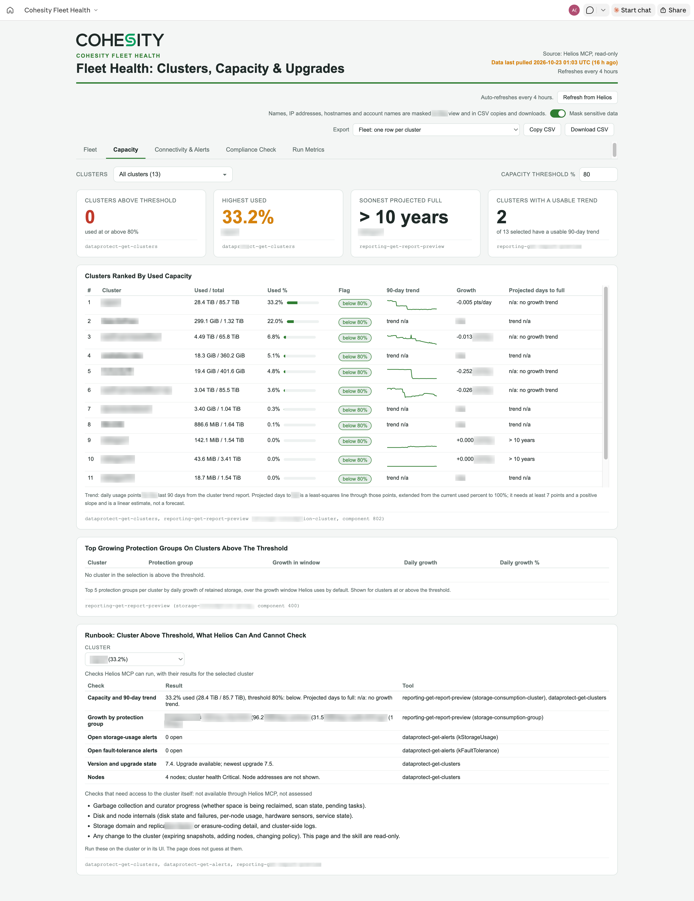
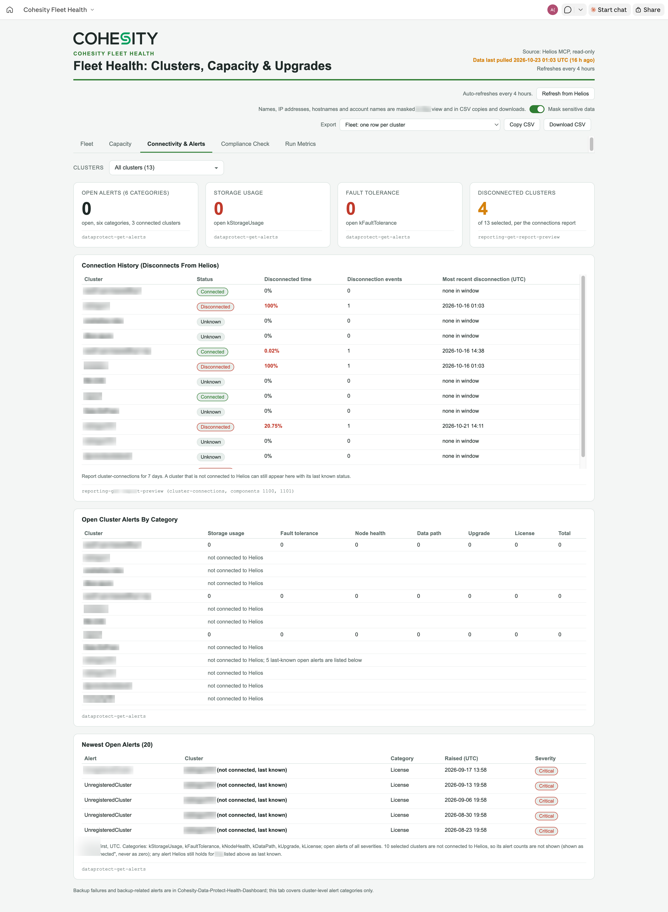
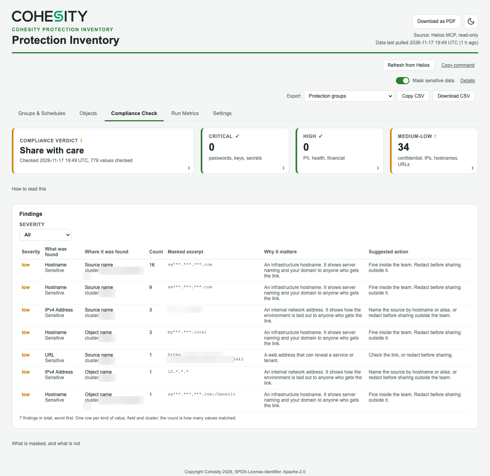
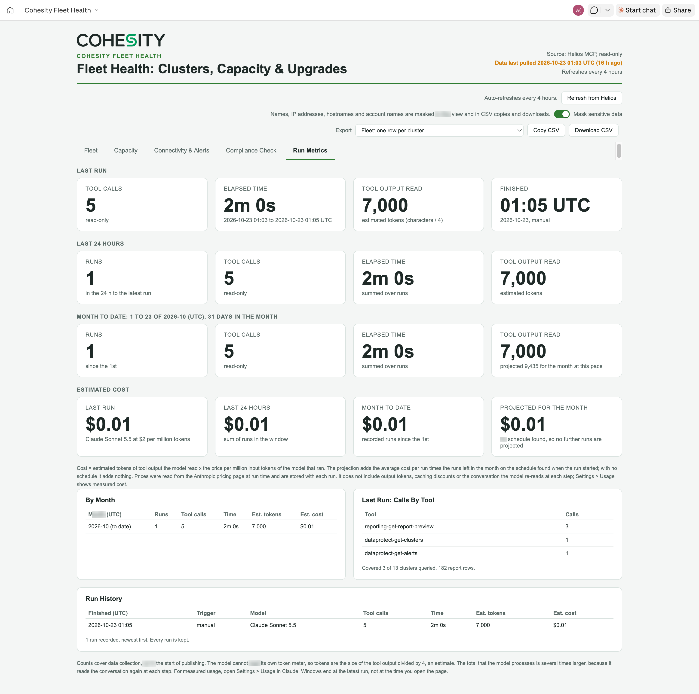

Copyright Cohesity 2026, SPDX-License-Identifier: Apache-2.0

# Fleet Health: Claude Sample Output

Sample output of the Claude skill [`Cohesity-Fleet-Health/SKILL.md`](Cohesity-Fleet-Health/SKILL.md). For install and use, see the [main README](../README.md). Every page has the Cohesity logo top-left and "Data last pulled" with its age top-right. The header also has a single sun/moon theme toggle (follows the browser; a click flips this view only and it resets when the browser changes) and the page ends with the footer "Copyright Cohesity 2026, SPDX-License-Identifier: Apache-2.0". Screenshots are from the published artifact; cluster and group names are lab data (with the mask switch on, group names are shortened to two letters plus ***; the screenshots were taken before that change).

## Fleet

The Fleet tab opens on widgets: a hero ring for clusters connected to Helios, tiles (critical health, at or above threshold, upgrades available, soonest full, open alerts) with change chips and, from the third refresh on, trend sparklines, a cluster health bar and a What changed since last refresh panel. The Summary sentences are behind a Read as text link. Notices (partial results, AI agents off) are short pills with Details; long notes sit in How to read this. A Download as PDF button in the header controls builds one PDF with a section for every report tab (Settings is not exported) in the browser (needs cdnjs.cloudflare.com; saved through the downloads capability, which asks you to confirm).

## Capacity

Used capacity, projected full date and trend per cluster, plus a Days to full bar chart (bands under 30, 30 to 89 and 90 days or more).

## Connectivity & Alerts

Disconnected clusters and open alerts, with a heat map of open alerts by cluster and category.

## Compliance Check

Checks the metadata shown on the page for personal data, secrets and infrastructure details before the page is shared.

## Run Metrics

Tool calls, elapsed time, estimated tokens and estimated cost for the last run, the last 24 hours and the month to date, plus the full run history. Under the cost tiles a **Pricing source** card shows where the skill reads the price per million input tokens (default: Anthropic's public pricing page); people who can edit the page can save another link, for example a page or file with a company price, and the page shows which source the last run used. The **Audit trail** button in the Run History card opens a read-only pop-up with every Helios call and the decisions around it, filters for category, status and run, a search box and a CSV download. A **Tool availability** table lists every Helios tool the skill can use with its status (available, partial, timed out, not licensed, disabled, not available, skipped), calls, the reason and what it affects; when a tool is unavailable the affected tab shows a note strip and "n/a" with the reason instead of failing.

## About the Settings tab

The last tab (the same canonical Settings block as every Cohesity skill page) explains how the page uses your data and holds one switch for the optional Cohesity AI agents (root-cause suggestions from Cohesity's LLM subscription), off by default. Switching it on opens a popup and needs your acceptance. The data tools are always used and send nothing through Helios to an LLM. The choice is saved per page and applies from the next refresh. A Refresh schedule card in the same tab shows the schedule the skill saw at its last run and lets an editor request a new one (every day, weekdays or weekly, a time and a time zone, or off; the skill converts it to the local time of the scheduling computer); the card then says "Not applied yet. Click Apply in Claude", and the link opens a Claude chat that applies it (no Helios data is pulled) so the card shows In sync. It needs the Cohesity-Fleet-Health skill and the Helios connector in the viewer's Claude, a viewer who is signed in to Claude (otherwise the links are disabled or hidden), and Claude open on that computer. The Refresh from Helios link works the same way (a new Claude chat with the command typed in; Copy command copies it). The table shows who last changed it and who accepted, as "Name (email)", masked by the mask switch; the email is looked up from the `me()` result (several field names), then from `user.profiles([id])`, then left empty. No screenshot yet. The Run Metrics tool availability and the "Not shown" strips describe the last refresh; when the live switch differs, the page says so ("Off at last refresh" when agents are on now, or "Cohesity AI agents are now off; this page still shows results from the last refresh"). A tool that returned some results is shown as partial, not unavailable.

## Settings

The Settings tab is the same on every Cohesity skill page. It lists what the page reads, where the data goes, and the one switch for the optional Cohesity AI agents (off by default), plus the **Refresh schedule** card.

## Audit trail

The **Audit trail** button in the Run Metrics tab (Run History card) opens a read-only list of every Helios call and decision of each run, with filters for category, status, run and search, and a CSV download.

## How Cohesity handles data sent to its LLM

Before the Cohesity AI agents can be switched on, the page shows this notice. The questions and answers are blurred in this sample; the page shows them in full.

